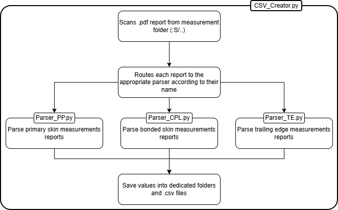

# A321 Flap Measurement Report Parser

Python toolkit used to automatically extract dimensional inspection data from SONACA measurement reports and export structured CSV files for statistical analysis.

The project processes multiple report families:
- PP (Primary Skins)
- CPL (Bonded Skins)
- TE (Trailing Edge)

The generated CSV files are already used in Excel but can also be used in Power BI or any SPC / trend analysis workflow.

---

## Overview

In python, the application scans measurement report folders, identifies valid reports based on file naming conventions, parses the PDF content, and generates dedicated CSV datasets.
Then with Excel, the use of Power Query help to refine these data.

### Workflow



The execution flow is describe in the next picture:

1. Scan PDF measurement report folders.
2. Filter reports using naming conventions.
3. Route each report to the appropriate parser.
4. Extract measurement values.
5. Export consolidated CSV files.

---

## Project Structure

```text
.
├── CSV_Creator.py
│
├── Parser_PP.py
├── Parser_CPL.py
├── Parser_TE.py
│
├── utils.py
├── config_template.py
│
├── Export LOWER PP/
│   └── *csv files
├── Export UPPER PP/
│   └── *csv files
├── Export LOWER CPL/
│   └── *csv files
├── Export UPPER CPL/
│   └── *csv files
├── Export TE/
│   └── *csv files
│
├── Excel/
│   ├── LOWER.xlsx
│   ├── UPPER.xlsx
│   └── TE.xlsx
│
├── docs/
│   ├── architecture.png
│   └── Archives/
│
└── README.md
```

---

## Main Components
### Configuration

Before running the project, create a `config.py` file based on `config_template.py` and update the folder paths to match your local environment.

---

### CSV_Creator.py

Main entry point of the project.

Responsibilities:

- Scan report folders.
- Select reports to process according to a patern file's names
- Detect report family (PP, CPL, TE).
- Call the appropriate parser.
- Generate CSV datasets.

---

### Parser_PP.py

Extracts dimensional data from Primary Part reports.

Supported measurements:

- Skin Free State
- Skin Restrained State
- EEOP
- Hole Pattern
- COS hole groups
- DA hole groups
- ENG hole groups

---

### Parser_CPL.py

Extracts dimensional data from Complete Part reports.

Supported measurements:

- Skin Free State
- Skin Restrained State
- Stringers Positions
- EEOP

---

### Parser_TE.py

Extracts dimensional data from Trailing Edge reports.

Supported measurements:

#### Skin

- Skin Upper
- Skin Lower

#### EEOP

- EEOP Upper
- EEOP Lower
- EEOP Inboard
- EEOP Outboard
- EEOP Trailing Edge

Current limitation:

- Hole positions are not yet implemented.
- OCR-based extraction could be used for future improvements.

---

## Example Output

Example CSV generated from extracted measurements:

```csv
OF,DATE,V68,V69,V70
50115603,2026-10-13,-0.24,0.12,-0.06
50115617,2026-10-20,-0.18,0.08,-0.03
```

---

## Usage

Run:

```bash
python CSV_Creator.py
```

Choose the report family:

```text
CPL
PP
TE
ALL
```

The application will automatically:

- Read matching PDF reports
- Extract measurements
- Update corresponding CSV files

---

## Technical Notes

### PDF Processing

The project relies on:

```python
pdfplumber
```

for PDF parsing and data extraction.

### Report Detection

Reports are automatically identified using naming conventions and regular expressions.

Only valid report formats are processed.

---

## Future Improvements

### Completed

- [x] PP parser
- [x] CPL parser
- [x] TE parser
- [x] Automatic CSV generation

### Planned

- [ ] Integration of hosting hole measurements for PP skins
- [ ] Automatic generation of skin measurement spreadsheets for PP reports
- [ ] TE hole extraction
- [ ] OCR cache system
- [ ] OCR incremental processing
- [ ] Data quality validation
- [ ] Power BI dashboard integration
- [ ] Statistical trend monitoring

## Known Limitations

- TE hole measurements are currently not processed.
- OCR extraction has not yet been implemented.
- Report naming conventions must follow the expected SONACA format.
- Some legacy report formats may require parser updates.

---

## Confidentiality Notice

This repository contains automation tools developed for the extraction and analysis of dimensional inspection data.

The source code does not include production reports, engineering drawings, customer data, or any confidential manufacturing records. Such data remains subject to internal company policies and applicable confidentiality agreements.

Users of this project are responsible for ensuring that any reports, datasets, screenshots, or generated outputs shared outside their organization have been appropriately reviewed and anonymized where required.

## Author

This project was designed to automate the extraction and consolidation of large quantities of dimensional inspection data from A321 flap manufacturing reports, enabling faster analysis and process monitoring.

Although the parsers have been validated on a large number of production reports, the generated datasets should be considered as engineering support data. Manual verification remains recommended, as report format variations may occasionally lead to missing or incorrectly interpreted values.

Developed by Louis Ridelle with AI-assisted support.

---

## Copyright

© 2026 LRidelle

All rights reserved.

This repository and its contents are intended for internal development purposes. No production reports, engineering data or proprietary manufacturing information are included.